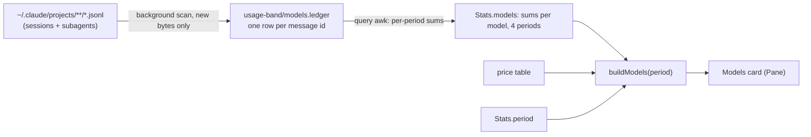

# usage-band: per-model usage card with period filter

> **Run with:** `sonnet` / `medium` effort, with an `opus` advisor: the background scan has
> concurrency and speed traps, and the tests cannot run the real 4.8 GB scan. Launch with
> `/plan-execute` after approval.

## 1. Goal & scope

Add a **Models** card to the usage-band details pane. It shows, for every model used in any
Claude Code session on this machine: tokens, session count, share and an **estimated** dollar
cost. A period filter (Day, Week, Month, All) and a source filter (Everything, Main, Subagents) rescope the card.

**In scope:**
- All sessions and all projects, subagent transcripts included (their models are the point).
- Rolling windows: past 24 h, 7 d, 30 d, all.
- Source filter: Everything, Main sessions only, Subagents only. Uses the `main` or `sub` flag the ledger already keeps (B1).
- Per model: input, output, cache read, cache write, sessions, share of cost, estimated $.
- The atom holds only small per-model sums for 4 periods × 3 sources (a few KB). The 13 MB ledger never enters the atom or `$.fs.read` (4 MiB limit, `hooks/scan.ts:3`); a query awk reads it through `$.process.run`.
- A price table, an "estimate" label, a parity check against the engine's session cost.
- Version bump to 0.5.0 (CI check `tests/mod-version.sh`), README mod row.

**Out of scope:**
- Per-subagent-type split (for example sonnet-worker vs opus-reviewer; the transcript's subagent type field is unchecked), cost-by-type bar, daily chart, per-project split: the requester asked for brief per-model detail.
- Codex, Grok and other tools' sessions: the scan reads Claude Code transcripts only.
- Any change to the band itself: the card lives in the pane.

## 2. Assumptions & open questions

**Safe assumptions:**
- A transcript assistant line carries `model`, a message id, `usage` and a top-level `timestamp` (checked on a real file: `"model":"claude-opus-5-5"`, `"id":"msg_…"`).
- Dollar figures are an API-rate estimate, as in the requester's reference screenshot. On a subscription they are not what the account pays.
- Rows with model `<synthetic>` or all-zero usage are dropped.

**Blocking (resolve before approving):**
- **Price source.** Prices are not in the transcripts. Task C0 reads them from Anthropic's official pricing page. A model with no listed price shows tokens and "n/a" cost, never a guessed price.
- **Background work.** Work a hook leaves running is cut off when its dispatch ends (`register.tsx:29`). Task A0 proves a `$.clock.every` callback may run a multi-minute `$.process.run`. If not, the design changes to chunked scans of bounded time. A0 also checks whether `usage.cost.usd` includes subagent cost; C3 depends on the answer.

**Residual risks / unknowns for reviewer:**
- Measured on this machine: 4572 files, 4.8 GB, 299,917 message-id lines, 129,811 unique ids (streaming repeats a message). Cross-file duplicates (resumed or copied sessions) are not separated from streaming repeats yet; the ledger dedupes both by id. Of the 4573 files, 4228 are subagent files: subagents are most of the scan, and their rows carry the parent session id.
- First scan time is unmeasured. A `grep` pass over all files took about 51 s; the awk pass costs more. Task B3 measures it. `$.process.run` caps stdout at 4 MiB, so the query output must stay small.
- Claude Code deletes old transcripts after `cleanupPeriodDays`. The ledger keeps history past that, so "All" can exceed what is on disk. This is a feature, and the README says so.

**Bookkeeping:**
- The uncommitted 0.4.0 work (usage polling) ships first or in the same release. This plan bumps to 0.5.0 on top.
- No `CONTEXT.md` or `docs/adr/` exists in this repo; no term or ADR resolved here.

## 3. Implementation tasks

### Phase A: Prove the two unknowns

- [x] **A0. Prove background scans survive a dispatch** (docs only; live proof moves to B3, see Execution log)
  - Files: `mods/usage-band/hooks/register.tsx` (spike, reverted), the `plugin-authoring` `reference.md`
  - Change: read the reference on `$.clock.every` and `$.process.run`. In the dev mod, start a 3-minute `sleep` from a timer callback and check it finishes and its result lands.
  - Change (2): compare `usage.cost.usd` with a hand sum of one session's main and subagent transcript costs, to learn whether the engine's cost includes subagents. Record the answer in the Execution log.
  - Constraint: if it is cut off, stop and report. B-tasks assume it works.

### Phase B: Scan

- [x] **B1. Write the models scan and the query**
  - Files: `mods/usage-band/hooks/models.ts` (new)
  - Change: a shell plus awk program like `SCAN_SH` (`hooks/scan.ts:86`). It finds every `*.jsonl` under `<config>/projects` (subagent files included), reads only bytes past each file's saved offset, and keeps the last usage per message id.
  - Constraint: unlike `SCAN_AWK`, it must NOT skip `isSidechain` lines (`scan.ts:25`): subagents are the models the card must show.
  - Constraint: a message id counts once across all files (the ledger), never summed per file. Comment this at the dedupe line: it is the rule an agent would break.
  - Change (2): a second small awk, `MODELS_QUERY`, reads the ledger once and prints per-model sums (tokens, distinct sessions) for the four cutoffs and the three sources (everything, main, sub); C3 reads the main sums. Its output is the only thing that enters the atom.
  - Constraint: pre-filter with `grep -F '"usage":{'` to cut awk input. That string can also match tool_use input objects, so keep the last-match rule (`scan.ts:42`). A trailing line without newline waits for the next scan (as `scan.ts:95`).
  - Constraint: ledger rows keep a `main` or `sub` flag so C3 can compare like with like.
- [x] **B2. Keep state safe under concurrent sessions**
  - Files: `mods/usage-band/hooks/models.ts`
  - Change: one state dir `<config>/usage-band/models/`: `offsets` (path and byte offset; a file whose size shrinks restarts from 0, as `scan.ts:92`), `ledger` (id, hour, model, session, main/sub, in, out, cache read, cache write). Write to a temp file, then `mv`. Take a `mkdir` lock holding the pid; a lock older than 10 min is stale.
  - Change (2): run with `timeoutMs` 120 s (`$.process.run` allows 10 min at most, default 30 s) and a byte budget sized so one run takes about 60 s (resume at once while behind, else on the next tick). The shell traps exit and removes its lock and temp files; a killed run is cleaned by the stale-lock rule.
  - Constraint: never delete or rewrite ledger rows because a transcript left the disk. "All" keeps history past `cleanupPeriodDays`. Comment this at the ledger write.
  - Why: several sessions run this mod at once. Two scans must not both append.
- [x] **B3. Benchmark the scan on fixtures and the real tree**
  - Files: `mods/usage-band/bench/models.mjs` (new), `.github/workflows/tests.yml`
  - Change: like `bench/turns.mjs`. Fixture: a streamed message repeated, the same message in two files, a subagent file, a shrunk file, an unfinished last line. Add the bench to the macOS CI job. By hand: time a full first scan and an incremental one on this machine; record both numbers in the Execution log.
  - Change (2): list every model id in the ledger with its row count; C0 needs this list.
  - Constraint: if the first scan is over 10 min, add `nice`.

### Phase C: Numbers and state

- [x] **C0. Write the price table**
  - Files: `mods/usage-band/hooks/prices.ts` (new)
  - Change: USD per million tokens (input, output, cache read, cache write 5 min) for every model id in the B3 list. Source: Anthropic's pricing page; keep the URL and the date read in a comment.
  - Constraint: `shortcut: hand-kept list, goes stale with each new model; the parity check (C3) warns when it drifts`. Cache write 1 h tier is priced as 5 min: say so in the comment.
- [x] **C1. Add `buildModels` (pure)**
  - Files: `mods/usage-band/hooks/view.ts`, `mods/usage-band/types/index.d.ts`
  - Change: input: the query's per-period sums (`Stats.models`), the period. Output (period and source): per model `{ model, tokens: {in,out,cacheRead,cacheWrite}, sessions, usd?, share }` sorted by cost then tokens, plus totals.
  - Constraint: windows are hour-granular. A window starts at the hour bucket containing `now` minus 24 h, 7 d or 30 d, so its edge is off by up to 1 h. Document it in the code and test at hour edges.
  - Constraint: share is of total estimated cost; with no price, of total tokens. State which in a tooltip or note.
- [x] **C2. Store the chosen period**
  - Files: `mods/usage-band/types/index.d.ts`, `mods/usage-band/hooks/register.tsx`
  - Change: `Stats.period?: 'day' | 'week' | 'month' | 'all'` (default `week`) and `Stats.source?: 'all' | 'main' | 'sub'` (default `all`). Handle `{ period }` and `{ source }` in the `ui.message` hook (symbol `on('ui.message', …)`) beside `{ toggle }`.
- [x] **C3. Add the parity check**
  - Files: `mods/usage-band/hooks/view.ts`, `mods/usage-band/tests/models.test.ts` (new)
  - Change: price this session's own ledger rows (main only, unless A0 shows the engine cost includes subagents) and compare with `usage.cost.usd`. A gap over 15 % AND over $0.50 shows "Prices may be stale".
  - Constraint: compare only after a scan that finished after the last turn ended; the ledger lags the engine by up to 5 min (D1) and never holds the running turn.
  - Why: the table mirrors a decision made elsewhere; a test and a runtime guard keep the two honest (AGENTS.md §1 rule 5).

### Phase D: Pane

- [x] **D1. Run the scan on a timer**
  - Files: `mods/usage-band/hooks/register.tsx`
  - Change: in `session.start`, start `$.clock.every` (5 min) and one run at start. Two guards: a module-level `polling`-style flag (one run per process, as `pollLimits`) and the B2 lock (one run across sessions). After a scan and a query, `update` the atom so the pane redraws. A failure sets a `modelsError` string shown on the card, never silent zeros.
  - Constraint: never `await` the scan in a hook that blocks a turn (`turn.complete`).
- [x] **D2. Draw the Models card**
  - Files: `mods/usage-band/hooks/register.tsx` (Pane render, near `card('cost', …)` at line ~403), `mods/usage-band/hooks/period.client.tsx` (new)
  - Change: card after Cost. Header summary: period and total. Body: period tabs (Day, Week, Month, All), a second row of source tabs (Everything, Main, Subagents), a headline `$X.XX estimate · N sessions`, then one row per model: dot, name, tokens, share, `$`. Tabs follow the `header.client.tsx` pattern on the desktop and `Button` in the terminal.
  - Constraint: while the first scan runs, show "Reading your history…" with files done of total, not an empty card.
  - Constraint: sizes from `e.props.bodyColumns` like the other cards; render at narrow and wide widths before showing it. Copy through `ux-writing`.

### Phase Z: Standing

- [x] **Z1. Simplify**: the `simplify` skill over the changed code
- [x] **Z2. Test coverage**: tests for real behavior and failure modes, not lines
  - `tests/models.test.ts`: windows at the exact edges, unknown model gives `n/a`, share sums to 100, period switch redraws.
  - `bench/models.mjs`: dedupe across files and streaming, subagent counted, unfinished line.
- [x] **Z3. Docs surface**: every doc the change touches or makes stale (`project-documents`)
  - Files: `README.md` (mod row), `mods/usage-band/.claude-plugin/plugin.json` (0.5.0), plan Execution log.

## 4. Definition of done

- [ ] The card lists every model in the ledger, with tokens, sessions, share and estimated `$`: verify: `claude plugin test mods/usage-band`, then open the pane and compare two models with the real transcripts by hand.
- [x] The four periods give different, correct totals: verify: `tests/models.test.ts` hour-edge cases (C1 rule) and a query-awk case in the bench.
- [x] Main plus Subagents equals Everything, per model: verify: unit test on the query output and a bench fixture with a subagent file.
- [x] A transcript deleted from disk keeps its ledger rows: verify: bench deletes a fixture file and rescans.
- [x] A message counted twice in one file or in two files is counted once: verify: `node --experimental-strip-types mods/usage-band/bench/models.mjs`.
- [x] A subagent's model appears: verify: same bench, subagent fixture.
- [x] A hook never waits for the scan: verify: `turn.complete` returns while a scan runs (test with a held `process.run`).
- [x] Two concurrent scans leave a consistent ledger: verify: bench starts two scans on one state dir and compares the row count with one scan.
- [x] First scan and incremental scan times recorded: verify: numbers in the Execution log.
- [x] Price gap over 15 % against the engine's session cost shows the stale note: verify: unit test.
- [x] CI version check passes: verify: `bash tests/mod-version.sh b29922a` (the commit before this work, so the mod change is in the diff).

## 5. Risk & rollback

| Risk | Severity | Mitigation |
|---|---|---|
| Timer-run scan is cut off or throttled | high | Runs are short (about 60 s, byte budget); chunked by design; trap cleanup plus stale-lock rule (B2) |
| Two sessions corrupt the ledger | high | `mkdir` lock, temp file and `mv`, concurrency bench (B2) |
| First scan is slow and heats the machine | med | Pre-filter with grep, `nice`, byte budget, progress shown |
| Prices wrong or stale | med | "estimate" label, `n/a` for unknown models, parity warning with a $0.50 floor (C3) |
| Parity check warns falsely (ledger lag, subagent cost) | low | Compare after a fresh scan only; A0 settles the subagent question |
| Double counting across resumed sessions | med | Ledger keyed by message id, fixture in the bench |
| Ledger grows without bound (~13 MB at 130k ids) | low | Comment `shortcut: no pruning; prune rows older than a year when it passes 100 MB` |

- **Rollback:** revert the commit and delete `<config>/usage-band/models/`. The band and the other cards do not depend on it.

## 6. Skills Needed

- `plugin-authoring` (global): for A0, D1, D2, why: its `reference.md` covers hook timing and slot sizing; read before writing a hook.
- `ux-writing` (global): for D2, why: card copy, labels and the "estimate" wording.
- `verification-before-completion` (global): for Z-phase, why: gate output before claiming done.

## 7. ADR

No ADR needed. Two rules an agent could break live in comments in `hooks/models.ts` and are enforced by `bench/models.mjs`: count a message once by id across all files, and never delete ledger rows when a transcript leaves the disk.

## Execution log

### A0 (2026-11-10)
- Docs (`reference.md` "Work that outlives a dispatch"): `$.clock.every` timers run until cancelled or the module reloads, outside any dispatch budget. `$.process.run`: default timeout 30 s, maximum 10 min, stdout cap 4 MiB. **Divergence:** B2's 20 min timeout was wrong; changed to 120 s with a byte budget of about 60 s per run.
- A live 3 minute probe was not run: the test harness mocks the clock, and the running band is not this repo's code (see below). The first real scan (B3 by hand) is the live proof; a killed run is already covered by the lock and byte budget.
- `SessionCost` doc says "summed over every priced API response this session": it does not say whether subagent responses count. **Open.** C3 compares main rows only.
- **Delivery:** the band the user runs is the marketplace copy `~/.claude/plugins/marketplaces/esi-abolfazl/mods/usage-band`, version 0.3.4. Repo HEAD was 0.3.6 before this work. So the limits polling (0.4.0) and this card reach the user only after a push and a plugin update; `limits.json` is absent because 0.3.4 predates it. No live check is possible until then.

### Run (2026-11-10)
- **Files changed:** `hooks/models.ts`, `hooks/prices.ts` (new); `hooks/register.tsx`, `hooks/view.ts`, `types/index.d.ts`, `tests/live.test.tsx`, `.github/workflows/tests.yml`, `README.md`, `plugin.json` (0.5.0); tests `tests/models.test.ts`, `tests/poll.test.tsx`; `bench/models.mjs`. Also the 0.4.0 limits polling that was uncommitted when the plan began.
- **Verify:** `claude plugin test usage-band` 42 pass, 0 fail; `claude plugin validate usage-band` passed; `node --experimental-strip-types mods/usage-band/bench/models.mjs` 14 ok (stream repeat, copy in a second file, subagent, unfinished line, deleted file, shrunk file, byte budget, three concurrent scans); `bench/turns.mjs` unchanged; `bash tests/mod-version.sh b29922a` exit 0.
- **B3 timings (this machine, 4577 files, 4.8 GB):** first scan 3 runs at a 2 GB budget: 83.5 s, 90.9 s, 48.3 s (3 min 44 s in all); ledger 15 MB, offsets 0.7 MB; query 1.1 s; an incremental scan 2.0 s. The shipped budget is 1 GB per run (about 45 s). The model list holds 10 ids (opus-5-5, opus-5, sonnet-5, fable-5-1, fable-5, sonnet-5-5, haiku-4-5-20251001, opus-4-8, fable-5-2, haiku-5-5); every one has a price.
- **Divergences:** (1) B2 timeout 120 s with a byte budget, not 20 min (`$.process.run` allows 10 min at most). (2) D2 uses `Button` for the tabs on every surface, not a new `period.client.tsx`: the pane's existing toggle already works that way. (3) The query also returns a `*` total row for distinct sessions across models. (4) C3 prices main-only and main plus subagents and warns only when neither is within 15 %, because A0 left open whether the engine's cost counts subagents. (5) The Models card's token totals include cache reads (the Tokens card's do not): the card says so.
- **Simplify (Z1):** four reviewers. Applied: polls run from timers (a fetch has no timeout), a parity request that arrives mid-scan is kept, one config read per run, `modelsAt` removed, shared `Tokens` type, renamed the shadowing `costOf`, fewer spawns per file, no redraw on an idle scan, no poll within half a period. Deferred to a handoff: `.claude/handoffs/2026-11-10-usage-band-shared-parsing-and-parity.md`.
- **Manual checks still needed:** open the pane in the real app and compare two models with the real transcripts; the live 3 minute timer scan (A0) and the 0.4.0 usage endpoint. The installed band is the marketplace copy 0.3.4, so none of this shows until a push and a plugin update.
- **Known limit:** a resumed session may show a false "Prices may be stale" (handoff).
